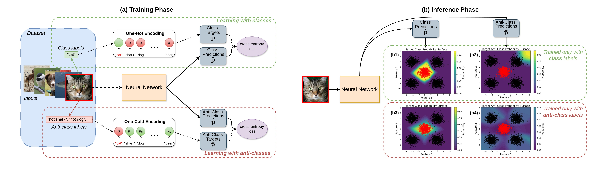

# robosapiens-AntiClass: Inducing Neural Collapse via Anticlasses and One-Cold Cross-Entropy Loss

[](LICENSE)
[](https://www.python.org/)
[](https://pytorch.org/)
[](https://ieeexplore.ieee.org/document/11053771)

Official PyTorch implementation of [**Inducing Neural Collapse via Anticlasses and One-Cold Cross-Entropy Loss**](https://ieeexplore.ieee.org/document/11053771) (IEEE TNNLS, 2025).

**Authors:** Dimitrios Katsikas, Nikolaos Passalis, Anastasios Tefas

AntiClass provides the one-cold cross-entropy (OCCE) loss, a drop-in objective that is used together with the standard cross-entropy to structure the activations of the non-target classes. For every class we define an *anticlass*, i.e. everything that does not belong to the class, and train the network to spread its activations uniformly over it. This increases the degree of neural collapse during training and improves generalization in classification, open-set recognition and OOD detection.

<p align="center">
  
</p>

## Abstract

While softmax cross-entropy (CE) loss is the standard objective for supervised classification, it primarily focuses on the ground-truth classes, ignoring the relationships between the nontarget, complementary classes. This leaves valuable information unexploited during optimization. In this work, we propose a novel loss function, one-cold CE (OCCE) loss, which addresses this limitation by structuring the activations of these complementary classes. Specifically, for each class, we define an anticlass, which consists of everything that is not part of the target class—this includes all complementary classes as well as out-of-distribution (OOD) samples, noise, or in general any instance that does not belong to the true class. By setting a uniform one-cold encoded distribution over the complementary classes as a target for each anticlass, we encourage the model to equally distribute activations across all nontarget classes. This approach promotes a symmetric geometric structure of classes in the final feature space, increases the degree of neural collapse (NC) during training, addresses the independence deficit problem of neural networks, and improves generalization. Our extensive evaluation shows that incorporating OCCE loss in the optimization objective consistently enhances performance across multiple settings, including classification, open-set recognition, and OOD detection.

## RoboSAPIENS and INTO-CPS

AntiClass was developed at the Computational Intelligence and Deep Learning (CIDL) group, Aristotle University of Thessaloniki, within the **RoboSAPIENS** Horizon Europe project. It is distributed as part of the RoboSAPIENS / INTO-CPS open-source software ecosystem.

- **RoboSAPIENS project:** https://robosapiens-eu.tech/
- **INTO-CPS software catalogue:** https://into-cps.org/software

## Repository structure

```text
.
|-- assets/                   # Figures used in the README
|-- experiments/
|   `-- run_cifar100.sh       # Reproduces the CIFAR-100 results (3 seeds, CE vs. CE+OCCE)
|-- logs/                     # Example TensorBoard logs (CIFAR-100, PreActResNet-18)
|-- losses/
|   `-- losses.py             # OCCELoss and the baseline losses
|-- models/
|   |-- preactresnet.py       # PreActResNet-18/34/50/101/152
|   `-- densenet.py           # DenseNet-121/161/169/201
|-- scripts/
|   |-- train.py              # Training / evaluation entry point
|   `-- plot.py               # Accuracy curves from the TensorBoard logs
|-- utils/
|   |-- datasets.py           # MNIST, CIFAR-10, CIFAR-100 loaders
|   `-- utils.py              # Seeding and metric helpers
|-- CITATION.cff
|-- CONTRIBUTING.md
|-- LICENSE
|-- RELEASE_NOTES_v0.1.0.md
`-- requirements.txt
```

## Installation

```bash
git clone https://github.com/INTO-CPS-Association/AntiClass.git
cd AntiClass

python -m venv .venv
source .venv/bin/activate
pip install -r requirements.txt
```

A CUDA-capable GPU is recommended. Make sure the installed PyTorch build matches the CUDA version on your system. Datasets are downloaded automatically to `data/` on the first run.

## Training

All commands are run from the repository root. The following reproduce the closed-set classification results of Table 1 of the paper for a PreActResNet-18 (ResNet18v2) on CIFAR-100.

Baseline cross-entropy:

```bash
python scripts/train.py --model preactresnet18 --dataset cifar100 --w_ce 1.0 --w_occe 0.0 --gpu 0 --seed 0
```

Unified CE + OCCE with γ = 1.0:

```bash
python scripts/train.py --model preactresnet18 --dataset cifar100 --w_ce 1.0 --w_occe 1.0 --gpu 0 --seed 0
```

To run both settings for seeds 0, 1 and 2 and plot the results:

```bash
bash experiments/run_cifar100.sh
```

Main options of `scripts/train.py`:

| Parameter | Description |
|---|---|
| `--dataset` | `mnist`, `cifar10` or `cifar100` |
| `--model` | `preactresnet18` or `densenet121` |
| `--w_ce` | Weight of the cross-entropy loss |
| `--w_occe` | Weight of the OCCE loss (γ in the paper). We suggest a grid search in (0.01, 1) |
| `--n_epochs` | Number of training epochs (default 150) |
| `--lr`, `--milestones`, `--gamma` | SGD learning rate and step schedule |
| `--seed` | Random seed |

Logs and the best checkpoint are written to `logs/<dataset>/<model>/<experiment>/`.

## Example logs

We provide example TensorBoard logs for three training runs (different seeds) in `logs/`. The baseline CE model achieves 24.83% test error, while adding OCCE reduces it to 23.80%. The small ~0.1% differences from the paper are due to different PyTorch versions, but the overall behavior should match across versions. To plot the accuracy curves from these logs:

```bash
python scripts/plot.py
```

The figure is saved under `figures/`.

## Using OCCE in your own code

`OCCELoss` in `losses/losses.py` can be added alongside the cross-entropy criterion of any training procedure:

```python
from losses import OCCELoss

ce, occe = nn.CrossEntropyLoss(), OCCELoss()
loss = ce(logits, targets) + gamma * occe(logits, targets)
```

In the paper we used this approach to evaluate the method in several settings, relying on the following repositories:

- **Open-set recognition:** [Adversarial Reciprocal Points Learning for Open Set Recognition (TPAMI'21)](https://github.com/iCGY96/ARPL)
- **Out-of-distribution detection:** [OpenOOD: Benchmarking Generalized OOD Detection](https://github.com/Jingkang50/OpenOOD)
- **Measuring neural collapse:** [A Geometric Analysis of Neural Collapse with Unconstrained Features](https://github.com/tding1/Neural-Collapse)
- **Measuring independence deficit:** [Rank Diminishing in Deep Neural Networks](https://github.com/Yukun-Huang/Rank-Diminishing-in-Deep-Neural-Networks)

## Citation

For more technical details and results, please check our [paper](https://ieeexplore.ieee.org/document/11053771). If you use AntiClass in your work, please cite:

```bibtex
@article{kat2025anticlasses,
  author  = {Katsikas, Dimitrios and Passalis, Nikolaos and Tefas, Anastasios},
  journal = {IEEE Transactions on Neural Networks and Learning Systems},
  title   = {Inducing Neural Collapse via Anticlasses and One-Cold Cross-Entropy Loss},
  year    = {2025},
  pages   = {1-12},
  doi     = {10.1109/TNNLS.2025.3580892}
}
```

## License

AntiClass is released under the **Apache License 2.0**. See [`LICENSE`](LICENSE) for details.

## Acknowledgment

This work was supported by the RoboSAPIENS project funded by the European Commission's Horizon Europe programme under grant agreement No. **101133807**.

This publication reflects the authors' views only. The European Commission is not responsible for any use that may be made of the information it contains.

<p align="center">
  
</p>
<p align="center">
  Learn more about <a href="https://robosapiens-eu.tech/" target="_blank"><strong>RoboSAPIENS</strong></a>.
</p>
<p align="center">
  
</p>
